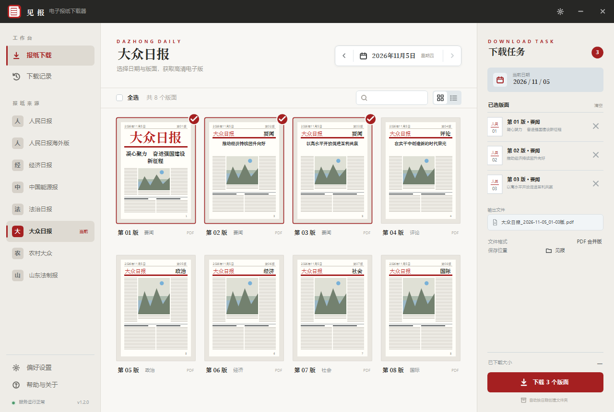

# 见报 · 电子报纸下载器（C++ / Win32 原生）

按日期下载报纸电子版各版面的官方 PDF，按版序合并为一份完整的当日报纸。

[](https://github.com/36953/jianbao/releases/latest)
[](LICENSE)


- **四家报纸来源**：人民日报、经济日报、法治日报、大众日报（均为公开、免登录、按日提供 PDF 的数字报）
- **纯 Windows 原生程序**：Win32 无边框窗口 + GDI+ 自绘界面 + WinHTTP 网络 + 自研 PDF 合并器
- **无任何运行时依赖**：不需要 Python、浏览器或本地服务，单个 EXE 双击即用
- 界面按设计稿逐像素还原（配色、字号、间距取自 Figma 导出的 CSS 变量）

下载：[Releases 最新版](https://github.com/36953/jianbao/releases/latest) → `jianbao-v1.1.1-win64.exe`（即 `见报.exe`，v1.1.1，约 900 KB，单文件免安装）




---

## 一、使用

双击运行，打开三栏桌面窗口：

- **左栏**：工作台导航（报纸下载 / 下载记录）、**报纸来源（四家可切换）**、偏好设置
- **中栏**：日期步进器与日历、版面卡片网格（含仿真的报纸缩略图与真实头条标题）、搜索、全选、卡片/列表切换
- **右栏**：下载任务面板 —— 已选版面列表、输出文件名预览、文件格式与保存位置、进度条、已下载大小、下载按钮

流程：程序启动即探测并载入**当前来源**的最新一期 → 点选版面（或全选）→ 点「下载 N 个版面」→ 完成后弹提示并可一键打开目录。
切换报纸来源会立即按同一日期重新抓取版面，并把「最近一期」提示重置为该报纸的可下载日期。
下载记录写入 `%APPDATA%\见报\history.tsv`，偏好（含上次选择的报纸）写入 `settings.ini`，下次启动自动恢复。

成品文件名带报纸名，不同报纸可保存在同一目录而不冲突，例如
`人民日报_2026-11-05_01-20版.pdf`、`法治日报_2026-11-05_01-02版.pdf`。

命令行模式（同一 EXE，便于批量）：

```bat
见报.exe --sources
见报.exe --source fzrb --date 2026-11-05
见报.exe --source dzrb --latest
见报.exe --source ce --date 2026-11-05 --pages 1,5-8
```

| 参数 | 说明 |
| --- | --- |
| `--source ID` | 报纸来源（`rmrb` 人民日报 / `ce` 经济日报 / `fzrb` 法治日报 / `dzrb` 大众日报），默认 `rmrb`；也接受中文名 |
| `--sources` | 列出已接入的报纸来源 |
| `--date YYYY-MM-DD` | 指定日期 |
| `--latest` | 自动探测并下载最新一期 |
| `--pages 1,2,5-8` | 只下载指定版面（支持区间与逗号） |
| `--info` | 只列出当日各版名称 |
| `--out DIR` | 输出目录（默认：程序目录\报纸输出） |
| `--keep` | 保留分版临时文件 |
| `--render-ui PNG [w h] [日期] [状态] [来源]` | 离屏渲染界面截图，用于比对设计稿（状态：download/history/settings/calendar/loading/error/list/running） |

---

## 二、站点结构：四家报纸的版面与 PDF 规则

四家站点分属三种体系，解析方式各不相同。共同点是：**版面 PDF 均按日发布，可直链下载**，因此本工具能合并成整份报纸。

| 来源 | 版面页 | PDF 直链 | 版名/头条 |
| --- | --- | --- | --- |
| 人民日报（新版式，2025 年起） | `/rmrb/pc/layout/YYYYMM/DD/node_NN.html` | `/rmrb/pc/attachement/YYYYMM/DD/<guid>.pdf`，**必须从页面解析** | 导航文本 / `news-list` 首个条目 |
| 人民日报（旧版式） | `/rmrb/html/YYYY-MM/DD/nbs.D110000renmrb_NN.htm` | `/rmrb/images/YYYY-MM/DD/NN/rmrbYYYYMMDDNN.pdf`，可推导 | 仅导航文本，无文章列表 |
| 经济日报 | `paper.ce.cn/pc/layout/YYYYMM/DD/node_NN.html` | `/pc/attachment/YYYYMM/DD/<guid>.pdf`，藏在导航 `<input type="hidden" value=…>` 中 | 导航 `第NN版：要闻` / `#articlelist` 首条 |
| 法治日报 | `epaper.legaldaily.com.cn/fzrb/content/YYYYMMDD/PageNNTB.htm` | `/fzrb/PDF/YYYYMMDD/NN.pdf`，**可推导** | 版面导航块 `第NN版：要闻` / `newslist` 首条 |
| 大众日报 | `paper.dzwww.com/dzrb/content/YYYYMMDD/PageNNNU.htm` | `/dzrb/PDF/YYYYMMDD/NN.pdf`，**可推导** | 导航 `[NN]:要闻` / `newslist` 首条 |

要点：

- 人民日报新版式与经济日报同源（方正「pc/layout」数字报），但 PDF 目录名一个是 `attachement`（多一个 e），一个是 `attachment`。
- 后两家的版面页在**一个请求内**就列出全部版号、版名与 PDF 直链；人民日报与经济日报需按版逐个抓页面解析 PDF。
- 相对链接必须按 RFC 3986 回退目录层级：`../../../attachement/...` 从 `/pc/layout/202611/05/` 回退三层是 `/pc/`，不能简单剥离 `../`。
- 版名会从 `第05版：评论` 归一化为 `评论`；大众日报页面里指向版面页的「收藏本页」等功能链接会被排除。

> 已调研但**未接入**的站点：光明日报（`epaper.gmw.cn`）、中国青年报、杭州日报——它们只提供版面图片或 SVG 翻页，不提供 PDF；
> 中国教育报的 PDF 路径已被站点重写为首页；环球时报、北京日报对非浏览器请求返回 403/JS 挑战。因此不能并入本工具的合并流程。

---

## 三、PDF 合并：自研实现

不依赖任何第三方 PDF 库。各版 PDF 都是经典结构（明文对象 + xref 表，无对象流、无加密），
因此可以做「对象级搬运」合并：

1. **线性扫描对象**：定位 `N G obj … endobj`；遇到 `stream` 先按 `/Length` 跳过二进制数据。
   各报大量使用**间接长度** `/Length 49 0 R`，所以先扫出全部「裸整数对象」
   （`49 0 obj 7827 endobj`）建立数值表，再解析长度；当长度与 `endstream` 对不上时，
   回退到「找后面紧跟 `endobj` 的 `endstream`」来界定数据区。
2. **整体重编号**：为每个源文件分配对象号区间，逐对象加偏移；只改写**字典区**里的间接引用
   `n g R`，流数据整段原样照抄（字面字符串 `( … )`、十六进制串 `< … >`、注释 `%` 一律跳过）。
3. **重建页面树**：把每个页对象的 `/Parent` 指回新建的 `/Pages` 节点。
4. **引用完整性校验**：合并前逐个检查被引用的对象是否都在解析结果中，缺一个就立即中止并
   报出版号与对象号——宁可报错，也不产出缺图、缺页的残损 PDF。
5. **重建交叉引用表**：逐对象记录字节偏移，写出 xref 表与 trailer，并写入 `/Title`（UTF-16BE 十六进制串）。

合并后体积等于各版之和（实测大众日报 20 版 142.63 MiB，无膨胀），页数与源文件一致。

### 合并器修过的三个真实缺陷

| 症状 | 原因 | 处理 |
| --- | --- | --- |
| **个别页空白、图片消失**（大众日报最明显，人民日报偶发） | 把间接长度 `/Length 49 0 R` 里的**对象号 49** 当成数据长度，只跳过 49 字节，随后在二进制数据里乱找 `endobj`，把后面的对象整段「吞掉」；被引用的图像对象一旦缺失，部分阅读器干脆整页不画 | 预扫描裸整数对象以解析间接长度；长度不可信时回退搜索 `endstream` + `endobj` |
| 字典里的引用未被重编号，合并后指向错误对象 | 十六进制串判定写成「`<` 且后一个字符不是 `<`」，于是 `<<` 跳过第一个 `<` 后，第二个 `<` 被当成十六进制串开头，整段字典被原样照抄 | `<<` 单独处理，继续按 token 扫描 |
| 每版多出一倍空白页 | Info 字典里塞了 `/cfeng (<< /Contents 12 0 R /Type /Page >>)`，裸字节扫描把字符串内容当成页对象 | 页判定与引用改写都跳过 `( … )` 字面字符串 |

还有一类站点本身的问题：部分 `endstream` 与 `endobj` 紧贴写成 `endstreamendobj`，
早期实现要求关键字前后都有分隔符，会漏判对象结束位置，同样导致对象被吞。

> **回归验证方式**：用 MuPDF 把合并结果与各版原文件逐页渲染，比对文本、像素哈希与图像对象清单。
> 6 期（人民日报 ×2、经济日报、法治日报、大众日报 ×2）共 93 个版面全部一致，无空白页。

## 四、界面实现要点

- **自绘无边框窗口**：`WS_POPUP | WS_THICKFRAME`，处理 `WM_NCCALCSIZE` / `WM_NCHITTEST`，
  用 `DwmSetWindowAttribute(hwnd, 33, DWMWCP_ROUND)` 取系统圆角
- **矩形热点表**：每帧重建命中区域，逆序判定，使浮层（日历/弹窗/提示）优先于下层
- **离屏渲染**：整帧画到缓存 `Bitmap` 再一次性 blit，避免闪烁；`--render-ui` 复用同一绘制
  代码在无窗口状态下出图，便于逐状态核对
- **设计令牌**：`ui_theme.h` 中的颜色/尺寸常量直接对应设计稿 CSS（如 `BrandRed #B82222`、
  `ContentBg #F8F7F4`、标题栏 48px、左栏 210px、右栏 286px）
- **字距模拟**：GDI+ 无 letter-spacing，`Tracked()` 逐字符绘制还原小标签字距
- **每版缩略图**：`PaperThumb()` 用矢量绘制仿真报纸版面（报头/头条/三栏正文/图片/版号），
  报头文字取当前来源，头条标题取页面真实解析结果；解析不到时以占位线条呈现，不虚构标题
- **高 DPI**：Per-Monitor V2，`S(v) = MulDiv(v, dpi, 96)` 统一缩放

---

## 五、重新构建

```bash
pip install ziglang        # 自带 Windows C/C++ 工具链，无需安装 VS
bash build.sh
```

`build.sh` 使用 `zig c++ -target x86_64-windows-gnu -Wl,--subsystem,windows` 交叉编译，
资源（图标与版本信息）由 `zig rc` 编译 `app.rc` 生成；图标由 `app.ico` 提供
（红色圆角方块 + 白色报纸图形，含 16/24/32/48/64/128/256 多尺寸），
需要调整图标时执行 `python tools/make_icon.py` 重新生成。

源码结构：

```
src/core.h        公共声明（日期、字符串、HTTP、来源表、站点、合并接口）
src/util.cpp      UTF-8/UTF-16、公历换算、文件操作、WinHTTP 封装
src/sources.cpp   四家报纸的来源表、版面导航解析、PDF 直链解析、头条提取、最新日期探测
src/pdfmerge.cpp  PDF 合并器
src/job.cpp       下载/合并任务（界面与控制台共用，支持来源与指定版面）
src/ui_theme.h    设计令牌（颜色、尺寸）
src/ui_draw.h/.cpp 矢量图标、字体缓存、基础图元、文本、仿真报纸缩略图
src/ui.h          界面状态模型（App / Settings / History / 命中区 ID）
src/ui_paint.cpp  整帧绘制（标题栏、左栏、下载页、任务面板、记录页、弹窗、日历、提示）
src/ui_app.cpp    窗口过程、事件循环、工作线程、设置与记录持久化、交互判定
src/main.cpp      入口：无参数开界面，有参数走控制台，--render-ui 出图
app.rc / app.ico  图标与版本资源
tools/make_icon.py 图标生成脚本（Pillow）
tools/make_source_doc.py  生成软著「源程序」文档（每页 50 行、前 30 + 后 30 页）
tools/make_manual_doc.py  生成软著「软件说明书」（含界面截图与目录页码）
tools/docx2pdf.ps1        调 Word 导出 PDF 并统计页数（Windows）
docs/shots/       界面截图（由 `--render-ui` 离屏渲染）
docs/软著/        软著登记材料：源程序与软件说明书的 docx、登记信息表
```

`dist\见报.exe` 与软著用的 PDF 属于派生产物，不入库：前者从 [Releases](https://github.com/36953/jianbao/releases) 获取，
后者用 `python tools/make_source_doc.py` / `tools/make_manual_doc.py` 生成 docx 后，再由 `tools/docx2pdf.ps1` 导出。

---

## 六、限制

- 各站点只提供其存档范围内的电子版；无报纸的日期返回 404，程序会提示该报纸当前最新可下载日期。
- 四家报纸的存档起点不同（人民日报最早，其余为近年），切换来源后若该日期无报纸会给出提示并可一键跳到最近一期。
- 若个别版面下载失败，仍会合并其余版面，并在日志中列出缺失版号。
- 整份报纸约 20–90 MB（广告版单版可达 10 MB 以上），下载耗时取决于网络。
- 并发默认 4 线程；不建议调得过高，以免对站点造成压力。

---

## 七、声明

本工具仅抓取上述报纸电子版站点公开的版面 PDF，用于个人学习、教学与研究。
内容版权归各报社所有，请勿用于商业传播或再分发。程序本身不存储、不分发任何报纸内容。

## 八、许可

程序代码以 [MIT 许可](LICENSE) 开源，Copyright (c) 2026 李强。
许可范围仅限程序代码，不含程序下载到的报纸内容。

本软件已完成计算机软件著作权登记材料整理（源代码文档与软件说明书），
版本号 V1.1.1，著作权人：李强。

## 九、更新记录

见 [CHANGELOG.md](CHANGELOG.md)。

